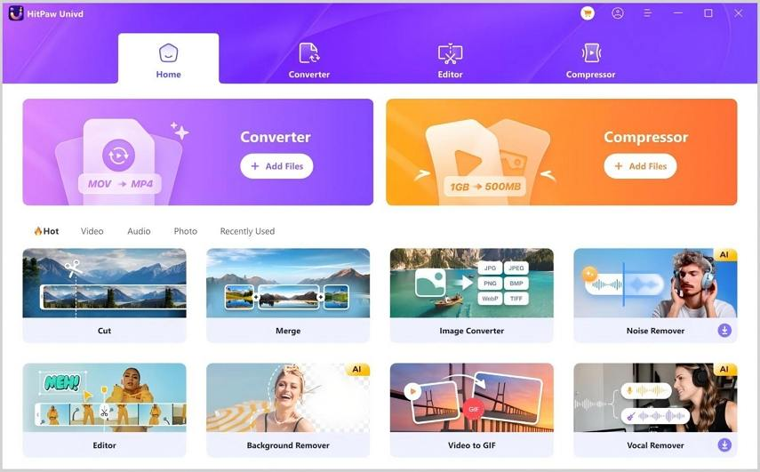
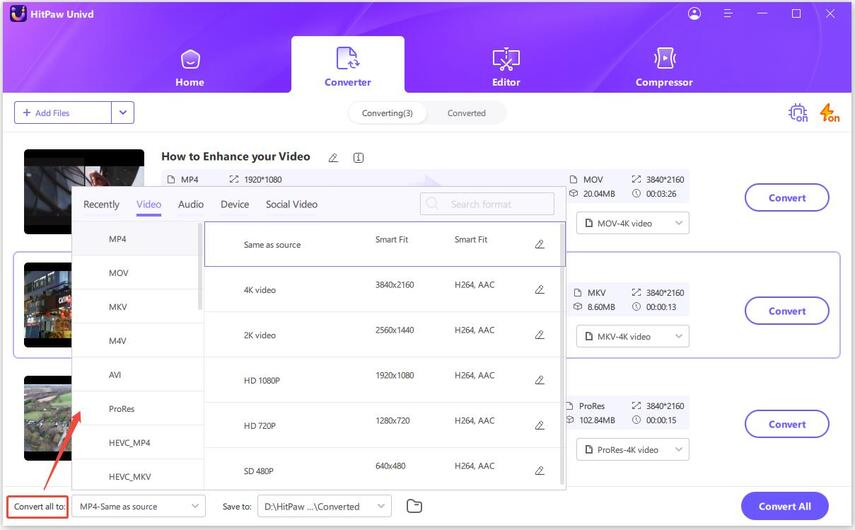

# HitPaw UniVD: Media Conversion with Output Control

HitPaw UniVD combines video and audio conversion, compression, editing, and selected AI tools in a desktop application for Windows and Mac.
The names hitpaw univd and hitpaw video converter refer to the current product and its former branding.
This guide focuses on choosing outputs that play correctly, fit delivery limits, and preserve the parts of a recording you need.

[](https://hitpaw-univd.github.io/Hitpaw-Video-Converter/)

## Separate the Container from the Encoding

An MP4 or MKV filename identifies a container; the video and audio inside it use their own codecs.
Changing the extension alone does not convert those streams or make them compatible with another device.
In hitpaw univd video converter, choose the output format and inspect the associated encoding settings before applying them to a queue.

| Output choice | Controls | Common reason to change it | Possible tradeoff |
| --- | --- | --- | --- |
| Container | Packaging of video, audio, and other tracks | Match a player or upload service | Some tracks may not fit the new container |
| Video codec | How pictures are encoded | Meet playback or storage requirements | More efficient codecs may need newer hardware |
| Resolution | Output pixel dimensions | Prepare a smaller delivery version | Fine detail can become less visible |
| Frame rate | Number of frames per second | Match a delivery specification | Unnecessary changes can alter motion |
| Audio codec and bitrate | Audio compatibility and compression | Produce a listening copy or smaller video | Lossy encoding can introduce audible artifacts |

Keep the original media so that later deliveries can use the original frames and audio.
For a first comparison, change one setting at a time and review a representative sample.

## Keep a Queue Consistent without Treating Every Clip Alike

Group recordings by source characteristics and intended destination before using batch conversion.
A screen recording with small text and a fast-moving camera clip may need different compression choices.

1. Add a small representative group to the conversion queue.
2. Choose a destination format and review video and audio settings.
3. Check which files receive shared settings and which need individual adjustments.
4. Save outputs under distinct names or in a separate destination.
5. Play a completed sample before processing the remaining recordings.



Hardware acceleration can shorten supported conversion jobs, but results depend on the GPU, codec, and selected operation.
Enable it through the relevant preferences and compare an actual sample on your computer.
The [official technical FAQ](https://www.hitpaw.com/support/hitpaw-video-converter-faqs.html) describes acceleration settings and information useful for investigating slow conversions.

## Reduce Size by Making a Deliberate Tradeoff

Compression means balancing storage, playback compatibility, and visible or audible changes.
For a training recording, legible text may matter more than retaining the original resolution.
For sports footage, preserving motion can matter more than making the smallest possible file.

- Trim unwanted sections before deciding how aggressively to compress the remaining content.
- Compare detailed textures, scene changes, and dark areas when judging video artifacts.
- Listen to speech and music separately when evaluating audio compression.
- Check the actual output size against the destination's limit.

### Read Bitrate Settings in a Concrete Example

The supplied FFmpeg presets offer examples of how encoder parameters are recorded.
Compare [libvpx-360p.ffpreset](presets/libvpx-360p.ffpreset), [libvpx-720p.ffpreset](presets/libvpx-720p.ffpreset), and [libvpx-1080p.ffpreset](presets/libvpx-1080p.ffpreset) as reference configurations.
The following subset of the 720p preset names an encoder, a quality-oriented deadline, and a target video bitrate:

```ini
vcodec=libvpx
deadline=good
cpu-used=0
b=2M
```

A preset filename is not a substitute for checking the actual output dimensions.
The paired [libvpx-720p50_60.ffpreset](presets/libvpx-720p50_60.ffpreset) and [libvpx-1080p50_60.ffpreset](presets/libvpx-1080p50_60.ffpreset) provide further parameter comparisons.
These are FFmpeg configurations; use UniVD's own controls when setting up a UniVD conversion.

## Decide Whether the Content Needs Editing or Repair

Use trimming, cropping, rotation, and merging to resolve structural issues before spending time on enhancement.
Cropping removes picture content, while resizing changes the dimensions of the whole picture.
Keep those operations separate when preparing the same recording for horizontal and vertical layouts.

The phrase hitpaw univd ai video converter covers several tasks that should be evaluated independently.
Speech-to-text creates a text representation of speech; noise removal targets unwanted sound; vocal separation addresses a different audio problem.
Check the tools included in your installed version and the credits or entitlement required for the chosen operation.



Preview a short section that contains the problem you want to fix.
Listen for altered consonants after noise reduction and inspect faces and textures after enhancement.
A higher output resolution cannot guarantee recovery of information absent from the source.
For captions, review names, punctuation, and timing before using generated text.

## Extract Audio or Change Packaging with FFmpeg

The following companion examples use an independently installed FFmpeg executable and its [documented options](https://ffmpeg.org/ffmpeg.html).
They illustrate media operations alongside a GUI workflow.

### Keep Compatible Streams while Repackaging

For an MKV containing MP4-compatible H.264 video and AAC audio, this Bash command copies the first video stream and optional first audio stream:

```bash
ffmpeg -i "camera.mkv" \
  -map 0:v:0 -map "0:a:0?" \
  -c copy "camera.mp4"
```

Stream copying avoids re-encoding the selected streams, so it cannot change their resolution or remove compression artifacts.
This example deliberately leaves other tracks out; keep the source if those tracks are needed.

### Make an MP3 Listening Copy

For a recording with an audio stream, this PowerShell example creates a separate MP3 using FFmpeg's libmp3lame encoder:

```powershell
$sourceMedia = "interview.mp4"
$listeningCopy = "interview-audio.mp3"
ffmpeg -i $sourceMedia -map 0:a:0 -vn -c:a libmp3lame -q:a 2 $listeningCopy
```

The FFmpeg build must include libmp3lame, and MP3 encoding is lossy.
For a hitpaw univd to mp3 task in the application, select an audio output and review its settings before converting.

## Verify the Delivery and the Product Edition

Open the delivered file in the player or service that will actually receive it.
Check the beginning and end, audio synchronization, orientation, and any required captions.
Retain an original and a clearly named delivery copy rather than repeatedly re-encoding the same compressed output.


If you search for hitpaw univd online, confirm whether the page describes a web tool or the desktop application.
Check the [official UniVD page](https://www.hitpaw.com/video-converter.html) for current product information and platform links.
For hitpaw univd price comparisons, check the selected operating system, license duration, device allowance, and AI credits at checkout.

## Accompanying Reference Files

The supplied source fragments belong to FFmpeg and are included as comparison material, not as the source code of HitPaw UniVD.
This subset contains presets and build support rather than a complete FFmpeg checkout; the separate HitPaw SDK selected earlier is also distinct from UniVD.
For the repository layout used by these links, upload the contents of the source folder and the separately supplied [HitPaw Univd.txt](HitPaw%20Univd.txt) brief into the repository root.

- [configure](configure) selects FFmpeg build features and checks dependencies.
- [arch.mak](ffbuild/arch.mak) selects architecture-specific object groups, while [common.mak](ffbuild/common.mak) provides shared build rules.
- [library.mak](ffbuild/library.mak) contains library build rules; [bin2c.c](ffbuild/bin2c.c) converts binary input into a C representation.
- [libversion.sh](ffbuild/libversion.sh) extracts library version definitions, and [version.sh](ffbuild/version.sh) prepares version information.
- [pkgconfig_generate.sh](ffbuild/pkgconfig_generate.sh) generates pkg-config metadata; [.gitignore](ffbuild/.gitignore) lists generated build artifacts to ignore.
- [project_facts.md](fairy/project_facts.md) records FFmpeg implementation and test conventions.
- [COPYING.GPLv2](COPYING.GPLv2) and [COPYING.GPLv3](COPYING.GPLv3) contain the supplied GPL license texts.
- [COPYING.LGPLv2.1](COPYING.LGPLv2.1) and [COPYING.LGPLv3](COPYING.LGPLv3) contain the supplied LGPL license texts.

## Related Search Terms

hitpaw univd, hitpaw video converter, hitpaw univd video converter, hitpaw univd ai video converter, hitpaw univd online, video, audio, multimedia, video-transcoding, video-editor, codec, mp4, webm, matroska, multi-platform
